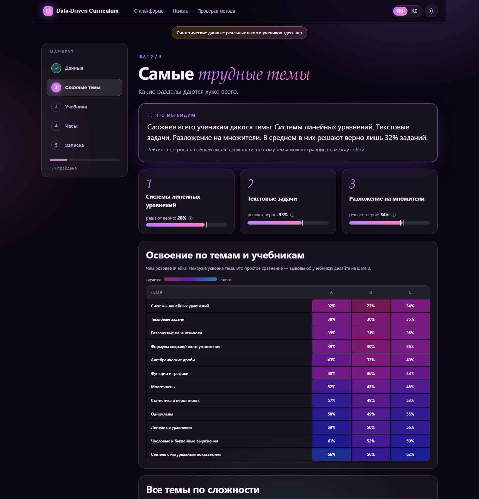
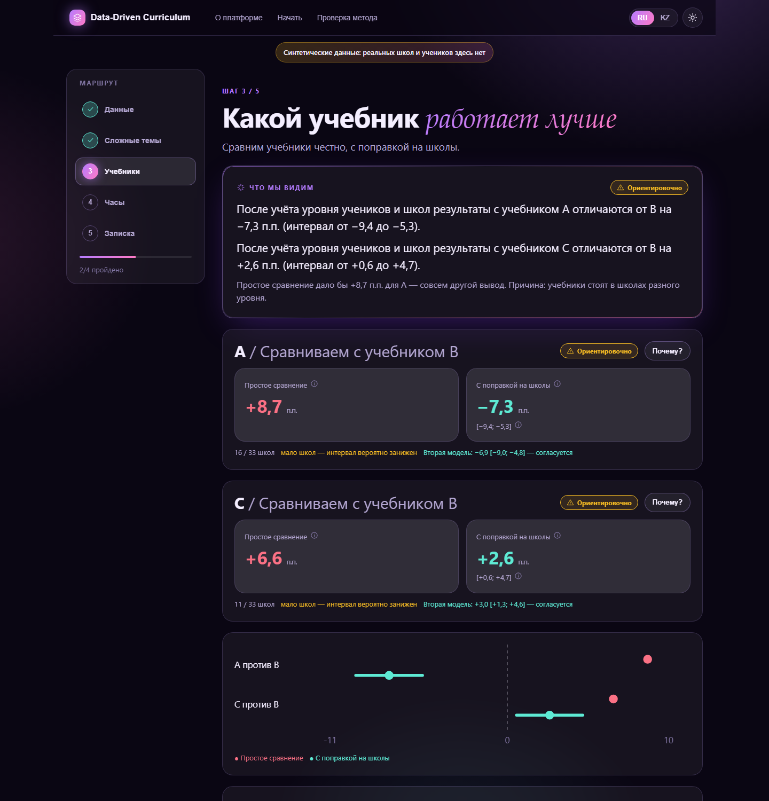
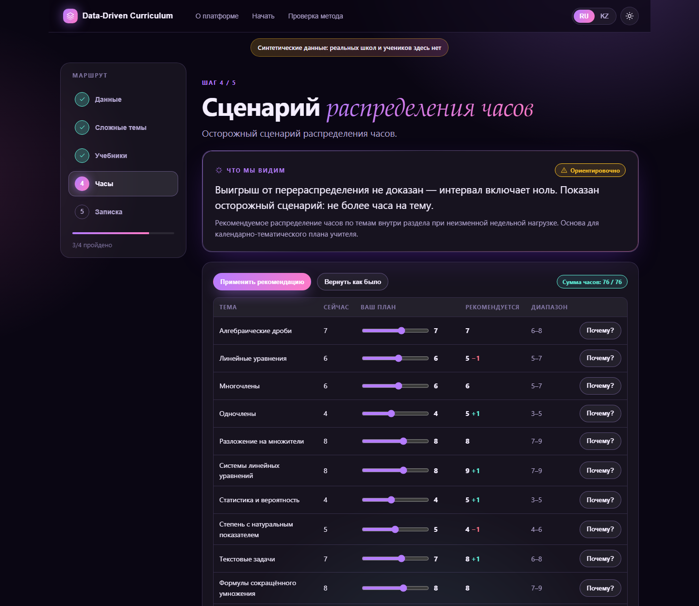
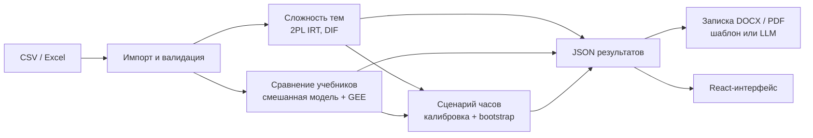

<div align="center">

# Data-Driven Curriculum

**Выбирайте учебник и часы по данным, а не по ощущениям.**

Платформа для методистов: находит трудные темы, честно сравнивает учебники с поправкой на контекст школ, предлагает осторожные сценарии распределения часов и готовит записку для методсовета на русском и казахском.

[Демо-сценарий](DEMO.md) · [Питч (PDF)](Data-Driven-Curriculum-pitch.pdf) · [Материал для слайдов](PITCH.md) · [Отчёт исследования](Аналитика%20учебников%20и%20часов%20РК.md)


</div>

> Кейс хакатона (Zhambyl hub): *«Data-Driven Curriculum: интеллектуальная система оценки эффективности учебников и учебных программ»*. Демо работает **только на синтетических данных**; реальные ФИО и ИИН платформа не принимает.

## Что умеет

| Вопрос методиста | Что делает платформа | Как показано |
|---|---|---|
| **Какие темы трудные?** | Рейтинг тем на общей шкале сложности (2PL IRT) с интервалом, поиск «плохих» заданий, проверка перевода (DIF по языкам обучения) | Тепловая карта «тема × учебник», топ-3 тем, таблица заданий |
| **Какой учебник лучше?** | Смешанная модель с поправкой на входной уровень учеников и школы, вторая модель для проверки, FDR по темам | «Простое сравнение» и «С поправкой» рядом, таблица по типам школ (парадокс Симпсона) |
| **Как распределить часы?** | Осторожный сценарий при неизменной сумме часов, калибровка отдачи по данным, bootstrap по школам | Ползунки «было → стало», прогноз с интервалом |
| **Что сказать методсовету?** | Записка DOCX и PDF на русском и казахском; нейросеть (необязательно) лишь переписывает резюме по готовым цифрам | Шаг 5, скачивание файлов |

К каждому выводу прилагаются кнопка **«Почему?»** (данные, метод, неопределённость, ограничения) и уровень доверия: *надёжно*, *ориентировочно* или *«Недостаточно данных для утверждения»*.

<table>
<tr>
<td width="33%"></td>
<td width="33%"></td>
<td width="33%"></td>
</tr>
<tr>
<td align="center"><sub>Трудные темы</sub></td>
<td align="center"><sub>Сравнение учебников</sub></td>
<td align="center"><sub>Сценарий часов</sub></td>
</tr>
</table>

### Принципы продукта
- **Честность вместо эффектности.** Интервалы, а не «точные» цифры. Формулировки «разница с поправкой на уровень учеников и школы», а не «учебник причиняет результат».
- **Простой язык.** Выводы словами, термины (IRT, FDR, GEE) уходят в раскрывающиеся блоки и подсказки.
- **Объяснимость.** Каждая рекомендация раскрывается до данных, метода и ограничений.
- **Осторожность с нормами РК.** Рекомендация по часам — «основа для КТП учителя при неизменной недельной нагрузке». Пределов «±N часов» в нормативных документах не найдено, поэтому они не используются.

## Быстрый старт

Нужны Python 3.11+ и Node.js 20+.

```bash
# 1. Бэкенд
pip install -r backend/requirements.txt
python -m uvicorn ddc.api:app --app-dir backend --port 8000

# 2. Фронтенд (в другом терминале)
cd frontend
npm install
npm run dev            # http://localhost:5173
```

При старте сервер в фоне прогревает оба демо-набора (~1,5 минуты). Признак готовности: `GET /health` возвращает `"warm": ["main", "small"]`. После этого кнопка «Открыть демо» срабатывает мгновенно.

Необязательно: чтобы включить нейросетевую переписку резюме, скопируйте `.env.example` в `.env` и задайте `OPENROUTER_API_KEY` (ключ в `.env` не попадает в git). Без ключа записка собирается из шаблона.

## Как это устроено



Ядро аналитики (`backend/ddc/`) не зависит от интерфейса. Модули **не читают** `ground_truth.json`: истина нужна только тестам и валидации.

### Методы

| Модуль | Метод |
|---|---|
| Импорт | Проверка типов, диапазонов баллов, дубликатов; отклонение колонок, похожих на ФИО, ИИН, телефон и т. п.; предупреждение, если в одной параллели несколько учебников |
| Сложность тем | 2PL IRT (EM с квадратурой Гаусса–Эрмита), интервал bootstrap по школам, дискриминативность заданий, проверка связности по якорным заданиям |
| DIF | 2PL отдельно по языкам, выравнивание по медиане, bootstrap по школам, FDR |
| Учебники | Смешанная линейная модель: учебник + тема + входной уровень + контекст школы (Mundlak) + язык + местность + стаж, случайный эффект школы; t-интервалы с поправкой на малое число школ; проверка биномиальной logit-моделью (GEE) |
| Темы × учебник | Отклонение темы от среднего эффекта учебника, поправка Бенджамини–Хохберга |
| Часы | МНК с контролями → сжатие к линии «сложность → отдача» → жадное целочисленное распределение при фиксированной сумме и границах; bootstrap по школам |

### Формат входных данных

Единица данных: **ученик × работа × задание × балл / максимум**. Схема не зависит от типа работы (СОР, СОЧ, промежуточная, суммативная).

| Файл | Обязателен | Колонки |
|---|---|---|
| `results_long` | да | `school_id, class, student_pseudo_id, task_id, section_or_topic, score, max_score` (+ необязательные `assessment_id`, `assessment_type`, `date` и др.) |
| `students` | для учебников и часов | `student_pseudo_id, prior_score` |
| `teaching` | для учебников | `school_id, class, textbook_id, teacher_experience_band` |
| `schools` | рекомендуется | `school_id, school_type, locality_type, instruction_language` |
| `hours` | для часов | `school_id, class, section_or_topic, planned_hours` |
| `items` | необязательно | описание заданий |

Шаблоны файлов можно скачать в интерфейсе («Скачать шаблоны файлов») или через `GET /templates`.

## Проверка качества

Метод проверен на симуляции с известной истиной (алгебра 7 класса, 60 школ, ~3 100 учеников, 12 тем, 86 заданий):

| Показатель | Результат (15 наборов) |
|---|---|
| Интервалы модели накрывают истину | **15 из 15** (для второй модели тоже 15 из 15) |
| Наивное сравнение называет не тот лучший учебник | 11 из 15 |
| Ранговая корреляция сложности тем с истиной, IRT | среднее 0,91 (минимум 0,77) |
| То же, классический индекс | среднее 0,90 (минимум 0,71) |
| Заложенные слабые места учебников по темам | найдены 2 из 2, без ложных |
| DIF | находит заложенные задания, на данных без DIF ложных срабатываний нет |

> **Важно.** Сценарий «учебник A стоит в сильных школах» заложен генератором, поэтому «11 из 15» — свойство симуляции, а не частота ошибок в реальности. Это проверка метода, а не доказательство работы в реальных школах.

**Часы.** Достижимый выигрыш от перераспределения в симуляции мал (≈0,04–0,14 п.п.), свободная оптимизация вредила, а рекомендация с шагом не более 1 часа в среднем близка к нулю. Поэтому часы подаются как консервативный сценарий. Результаты: [`backend/validation_hours.json`](backend/validation_hours.json), вкладка «Проверка метода».

## Тесты

```bash
cd backend
python -m pytest                                   # быстрые: ~2 минуты, 70+ тестов
python -m pytest -m slow tests/test_multiseed.py   # 15 наборов данных: ~8 минут
python validate_hours.py                           # валидация часов (результат в validation_hours.json)
```

Покрыто: воспроизводимость на seed 2026, покрытие интервалов на 15 seed, ошибка наивной модели и верность модели с поправкой, ранговая корреляция сложности ≥ 0,7, сохранение суммы и границ оптимизатором, отклонение некорректных файлов и ПД-колонок, якорные задания, DIF, API.

## API

| Метод | Путь | Назначение |
|---|---|---|
| `POST` | `/import` | загрузка файлов (CSV/Excel), отчёт о качестве |
| `POST` | `/demo/{main\|small}` | демо-наборы (основной 60 школ, резервный 28) |
| `GET` | `/analyze/difficulty` | сложность тем, задания, тепловые карты |
| `GET` | `/analyze/dif` | различия заданий по языкам |
| `GET` | `/analyze/textbooks` | сравнение учебников |
| `POST` | `/optimize/hours`, `/optimize/scenario` | рекомендация и прогноз для пользовательского плана |
| `GET` | `/why/hours`, `/why/textbook` | объяснение рекомендации |
| `GET/POST` | `/config` | просмотр и изменение порогов (с проверкой диапазонов) |
| `GET` | `/report?lang=ru\|kz&fmt=docx\|pdf` | записка для методсовета |
| `GET` | `/templates`, `/validation`, `/health` | шаблоны, результаты проверки, готовность |

Интерактивная документация: `http://localhost:8000/docs`.

## Структура репозитория

```
backend/
  ddc/                 ядро: импорт, IRT, сложность, DIF, учебники, часы, объяснимость, записка, API
  tests/               быстрые тесты и 15-seed проверка
  demo_data/           демо-наборы (основной и small/)
  validate_hours.py    эксперимент по часам
frontend/              React + Vite: лендинг, пошаговый маршрут, светлая/тёмная тема, RU/KZ
synthetic_dc/          генератор синтетических данных и исходные файлы
docs/img/              скриншоты для README
DEMO.md  PITCH.md      сценарий демо и материал для питча
```

Все пороги вынесены в [`backend/ddc/config.py`](backend/ddc/config.py) и частично редактируются в интерфейсе («Параметры анализа»). Пороги вроде «меньше 8 школ» — допущения проекта, а не нормативы: по литературе для смешанных моделей ориентир около 50 групп.

## Ограничения и честные оговорки

- Результат проверен на симуляции, а не на реальных школах. Дальше нужен пилот.
- Эффект учебника — разница с поправкой на **наблюдаемые** характеристики, не причинный эффект. Сравнение только межшкольное и только там, где в Перечне 2–3 альтернативы.
- Часы — сценарий при допущениях; интервал выигрыша включает 0. «Оптимальное распределение» не обещается.
- IRT-сложность лишь немного лучше простого индекса (0,91 против 0,90); для работ, которые решают разные группы учеников, нужны якорные задания (платформа проверяет связность и предупреждает).
- Казахская версия интерфейса и записки — **черновик**, требует вычитки носителем языка.
- Нормативные пометки «[ТРЕБУЕТ ПРОВЕРКИ В ШКОЛЕ/ОТДЕЛЕ ОБРАЗОВАНИЯ]» сохранены в [отчёте исследования](Аналитика%20учебников%20и%20часов%20РК.md). Реальные выгрузки Kundelik и BilimClass по заданиям не подтверждены, основной вход — CSV/Excel.

## Персональные данные

На хакатоне используются только синтетические данные. Платформа отклоняет файлы с колонками, похожими на ФИО, ИИН, дату рождения, телефон, e-mail или адрес. Для пилота: случайные токены вместо идентификаторов (таблица соответствий остаётся в школе), хранение в РК, письменные согласия, удаление данных по окончании пилота. Это не юридическое мнение: нужна проверка юриста.

## Дальше

- Пилот в одной школе и одном отделе образования по списку проверок из отчёта исследования.
- Реальные выгрузки журналов (Kundelik, BilimClass, Mektep) и работа с якорными заданиями.
- Вычитка казахской версии, экспертная проверка текстов записки.
- Лицензия и правила использования данных будут определены перед публикацией пилота.
